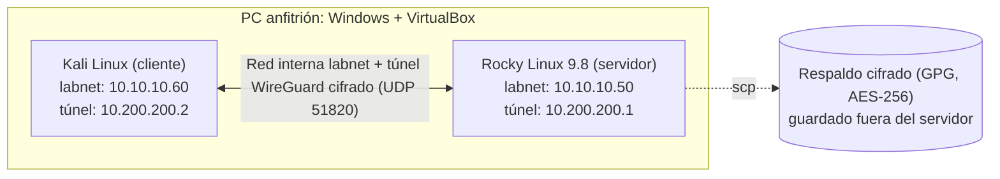
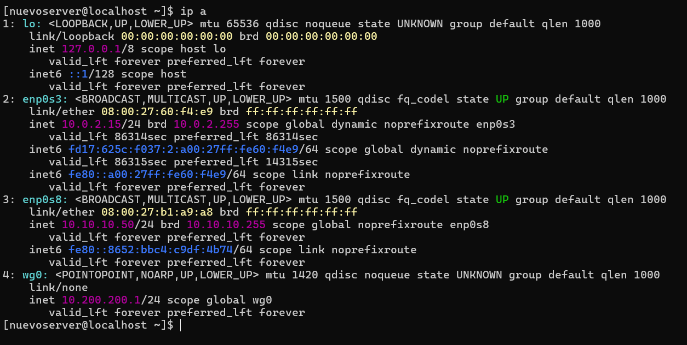
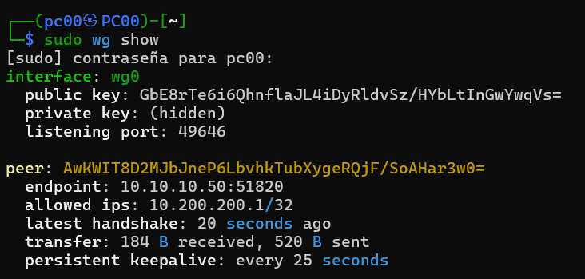
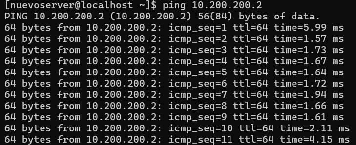
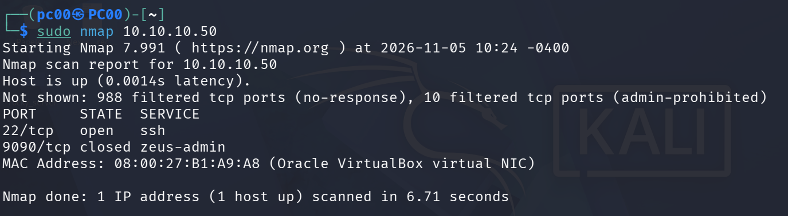
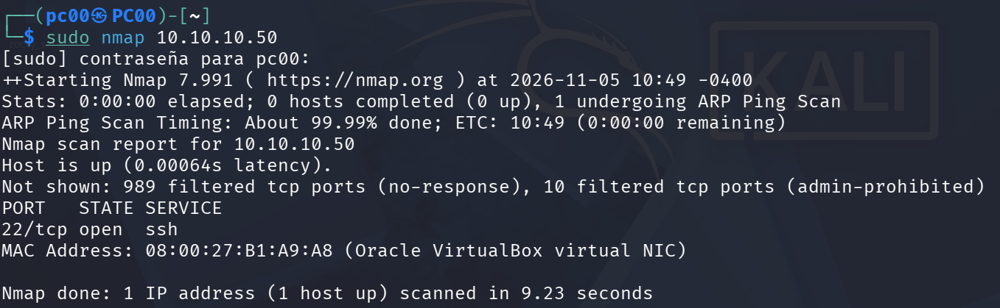
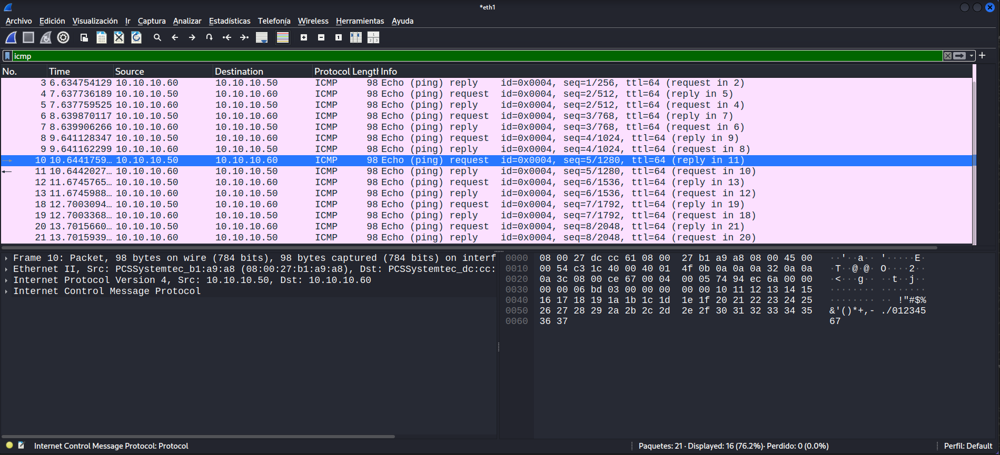
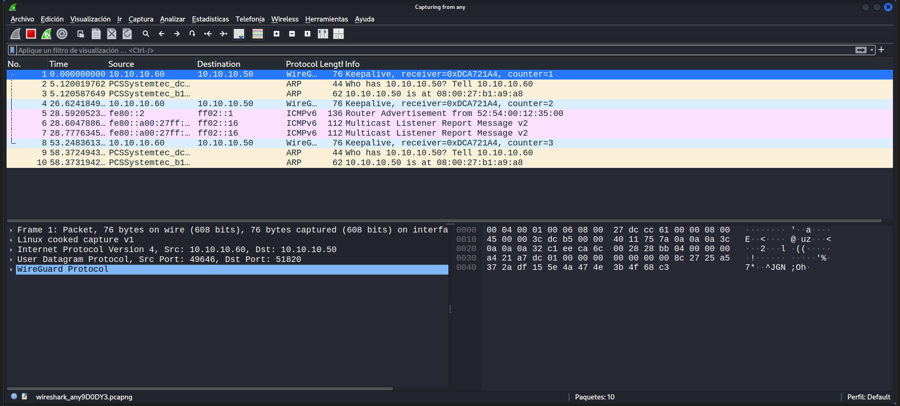
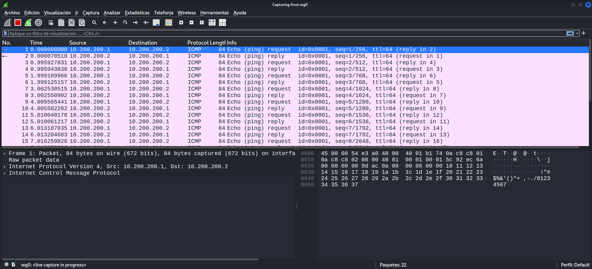

# WireGuard VPN Lab: respaldo cifrado, destrucción y restauración

Laboratorio virtual de ciberseguridad donde se construye una **VPN con WireGuard** entre un servidor Linux y un cliente Kali, se **protege** el servidor (hardening), se **respalda** de forma cifrada, se **destruye por completo** y se **restaura** recuperando la misma identidad en la VPN.

El ejercicio simula un escenario de **continuidad operativa y recuperación ante desastres**: mantener la infraestructura en línea y segura incluso después de perderla.

## Resultado

- Túnel cifrado funcionando entre Kali y Rocky (verificado con handshake y `ping`).
- Por TCP, el servidor solo expone SSH (verificado con Nmap). WireGuard escucha en `51820/udp`, pero no responde a paquetes que no estén firmados con una llave válida, así que no se delata ante un escaneo.
- Servidor destruido y restaurado desde un respaldo cifrado con AES-256.
- La llave pública del servidor restaurado es **idéntica** a la original: Kali no necesitó ningún cambio.


## Arquitectura



| Máquina | Sistema | IP en `labnet` | IP en el túnel |
|---|---|---|---|
| Servidor | Rocky Linux 9.8 | `10.10.10.50` | `10.200.200.1` |
| Cliente | Kali Linux | `10.10.10.60` | `10.200.200.2` |

Dos capas de red: `labnet` es una red privada aislada (sin cifrar) y el túnel WireGuard va **encima** y cifra todo el tráfico.

## Herramientas

VirtualBox · Rocky Linux · Kali Linux · WireGuard · SELinux · firewalld · fail2ban · GPG · SSH · Nmap · Wireshark

## Fases

### 1. Crear

- **Segmentación de red:** red interna `labnet` en VirtualBox con direccionamiento IP estático (`nmcli`).
- **VPN con WireGuard:** cada máquina tiene su par de llaves; cada lado solo acepta a la otra por su llave pública.

  ```ini
  # /etc/wireguard/wg0.conf (servidor)
  [Interface]
  Address = 10.200.200.1/24
  ListenPort = 51820
  PrivateKey = <LLAVE PRIVADA DEL SERVIDOR>

  [Peer]
  PublicKey = <LLAVE PÚBLICA DEL CLIENTE>
  AllowedIPs = 10.200.200.2/32
  ```

- **Hardening del servidor:**
  - SELinux en modo `Enforcing`.
  - Cuenta de root bloqueada (`passwd -l root`), administración con `sudo`.
  - Firewall con solo lo necesario: `ssh` y `51820/udp` (se cerró `cockpit`; queda `dhcpv6-client`, que viene por defecto).
  - fail2ban para SSH: 5 intentos fallidos = bloqueo de 1 hora.
  - Instalación mínima (`Server`) para reducir la superficie de ataque.

### 2. Verificar

- **Nmap** desde Kali: solo el puerto `22/tcp` está abierto.
- **Wireshark:** el tráfico del túnel aparece como protocolo `WireGuard` con el contenido ilegible; no se ve el ping que viaja adentro. Capturando en la interfaz `wg0` sí se ve el ping, porque es el tráfico antes de cifrarse.

### 3. Respaldar

```bash
sudo tar czf /tmp/respaldo.tar.gz /etc/wireguard /etc/fail2ban/jail.local
sudo gpg --symmetric --cipher-algo AES256 --pinentry-mode loopback /tmp/respaldo.tar.gz
scp usuario@10.10.10.50:/tmp/respaldo.tar.gz.gpg ~/       # copia fuera del servidor
sha256sum respaldo.tar.gz.gpg                              # misma huella en ambas máquinas
```

Se comprobó que el respaldo abre y lista su contenido antes de destruir nada, y se borró el original sin cifrar con `shred`.

### 4. Destruir

Se eliminó la VM del servidor por completo para simular una pérdida total o un compromiso.

### 5. Restaurar

1. VM nueva de Rocky 9.8 con la misma IP fija y SSH.
2. Instalación de `wireguard-tools` y `fail2ban`.
3. Descifrado y extracción del respaldo, y borrado seguro de la copia descifrada:

   ```bash
   gpg --pinentry-mode loopback --output respaldo.tar.gz --decrypt respaldo.tar.gz.gpg
   sudo tar xzf respaldo.tar.gz -C /
   shred -u respaldo.tar.gz
   ```

4. Reglas del firewall (abrir `51820/udp`, cerrar `cockpit`) y servicios activados en cada arranque (`systemctl enable --now`).
5. Verificación desde Kali: `ping` por el túnel y `wg show` con `latest handshake`.

El respaldo guarda la configuración y las llaves, pero **no** los programas instalados, las reglas del firewall ni la IP: esa parte hay que rehacerla, y quedó documentada en las [notas del laboratorio](notas-laboratorio.md).

**Hallazgo:** en el primer escaneo después de restaurar, Nmap mostró `9090/tcp closed`. Es el puerto de `cockpit`: el servidor nuevo trae esa regla del firewall por defecto y el respaldo no la guarda, así que había vuelto. Se cerró otra vez con `firewall-cmd --permanent --remove-service=cockpit` y se agregó ese paso al plan de restauración.

## Evidencia (servidor restaurado)

**Interfaces del servidor:** IP de `labnet` en `enp0s8` y el túnel `wg0` con `10.200.200.1`.



**Handshake desde Kali:** la llave privada aparece oculta (`hidden`) y hay un `latest handshake` reciente.



**Ping por el túnel** del servidor al cliente.



**Escaneo con Nmap** desde Kali, antes y después de cerrar `cockpit` (ver el hallazgo en la fase 5).

Antes: aparece `9090/tcp closed`.



Después: solo queda `22/tcp open`.



**Comparación en Wireshark:**

| Dónde se captura | Qué se ve |
|---|---|
| `eth1`, ping directo por `labnet` sin túnel | El `ping` (ICMP) se lee completo: cualquiera en la red podría verlo. |
| Tráfico real entre las máquinas | Solo paquetes `WireGuard` por UDP `51820` con contenido cifrado. |
| `wg0`, dentro del túnel | El `ping` se ve, porque es el tráfico antes de cifrarse. |







## Lo que aprendí

- La **llave privada es la identidad** de cada extremo de la VPN: quien la tenga puede hacerse pasar por esa máquina, por eso va con permisos `600` y el respaldo va cifrado.
- Un respaldo solo sirve si **se prueba antes de destruir** y se verifica su integridad con un hash.
- Un plan de restauración debe incluir lo que el respaldo **no** guarda (programas, firewall, red, usuarios). El caso de `cockpit` lo demostró.
- Después de restaurar hay que **volver a escanear**: no basta con que el servicio funcione, también hay que confirmar que no se abrió nada de más.
- Cada programa instalado y cada puerto abierto es una posible puerta: instalar lo mínimo y cerrar lo que no se usa.

## Seguridad de este repositorio

Las llaves privadas, el archivo de respaldo cifrado y las contraseñas **no se publican**. Los archivos de configuración se muestran con `<MARCADORES>` en lugar de las llaves reales, y el `.gitignore` bloquea llaves, respaldos y capturas de tráfico para que no se suban por accidente. Las llaves que aparecen en las capturas son solo **públicas**.

## Autor

**Isaac Brazoban**: estudiante de Técnico Superior en Ciberseguridad (UNISNORTE).
